# Estación 3: Sincronización de recursos compartidos

**Integrante 3:** Geanfranco Alexander Rodriguez Mendieta
**Laboratorio:** Concurrencia en Java y JavaFX (Programación de aplicaciones de escritorio, UAM)
**Rama:** `feature/Gean`
**Entorno:** JDK Temurin 21.0.12.1, Maven, JavaFX 21.0.6, IntelliJ IDEA

## 1. Qué se implementó

Todo el código está en `HilosJava/src/main/java/ni/uam/edu/hilosjava/`:

| Archivo | Función |
|---|---|
| `modelo/Contador.java` | Interfaz con `incrementar()` y `getTotal()`, para probar varias implementaciones con la misma tarea. |
| `modelo/ContadorCompartido.java` | Contador con `int total`. Primero sin protección y luego con `synchronized` en `incrementar()` y `getTotal()`. |
| `modelo/ContadorAtomico.java` | Contador basado en `AtomicInteger`. |
| `tareas/TareaIncremento.java` | `Runnable` que llama `incrementar()` un número fijo de veces. |
| `app/PruebaContador.java` | Programa de consola: dos hilos sobre el mismo contador, 10 ejecuciones, `join()` en el hilo `main` (nunca en el hilo de JavaFX). |

Para reproducir: ejecutar `PruebaContador` desde IntelliJ y cambiar la constante `REPETICIONES` (1 000 o 100 000). El valor esperado por ejecución es `2 * REPETICIONES`.

## 2. Predicción (antes de ejecutar)

**Sin sincronizar.** Se espera que el total final sea menor que el esperado en algunas ejecuciones. La causa es que `total++` no es atómico (lee, suma y escribe) y los dos hilos pueden leer el mismo valor a la vez, de modo que un incremento pisa al otro. Con 1 000 repeticiones por hilo el error debería ser poco frecuente, porque un hilo puede terminar casi antes de que el otro empiece. Con 100 000 repeticiones debería ser frecuente y con pérdidas grandes, porque los hilos se solapan mucho más. Además, el resultado debería cambiar de una ejecución a otra, sin un patrón fijo.

**Con `synchronized`.** Se espera que el total sea siempre exactamente 2000 (y 200000 con 100 000 repeticiones). Solo un hilo a la vez puede ejecutar `incrementar()`, así que los tres pasos de `total++` no se mezclan entre hilos.

**Con `AtomicInteger`.** Se espera el mismo resultado exacto que con `synchronized`, y un tiempo igual o menor, porque usa una instrucción atómica del procesador en lugar de un candado y no obliga a los hilos a esperar.

## 3. Resultados

### 3.1 Con 1 000 incrementos por hilo (esperado: 2000)

| Ejecución | Sin sincronizar | `synchronized` | `AtomicInteger` |
|---|---|---|---|
| 1 | 2000 | 2000 | 2000 |
| 2 | 2000 | 2000 | 2000 |
| 3 | 2000 | 2000 | 2000 |
| 4 | 2000 | 2000 | 2000 |
| 5 | **1948** | 2000 | 2000 |
| 6 | 2000 | 2000 | 2000 |
| 7 | 2000 | 2000 | 2000 |
| 8 | 2000 | 2000 | 2000 |
| 9 | 2000 | 2000 | 2000 |
| 10 | **1974** | 2000 | 2000 |

Sin sincronizar hubo pérdida en 2 de 10 ejecuciones (52 y 26 incrementos perdidos). Con `synchronized` y con `AtomicInteger`, 10 de 10 correctas.

### 3.2 Con 100 000 incrementos por hilo (esperado: 200000)

| Ejecución | Sin sincronizar (tanda A) | `synchronized` | `AtomicInteger` |
|---|---|---|---|
| 1 | **135015** | 200000 | 200000 |
| 2 | **103850** | 200000 | 200000 |
| 3 | 200000 | 200000 | 200000 |
| 4 | 200000 | 200000 | 200000 |
| 5 | 200000 | 200000 | 200000 |
| 6 | 200000 | 200000 | 200000 |
| 7 | 200000 | 200000 | 200000 |
| 8 | 200000 | 200000 | 200000 |
| 9 | **191518** | 200000 | 200000 |
| 10 | **180550** | 200000 | 200000 |

Las columnas de cada versión provienen de ejecuciones distintas del programa.

### 3.3 Repetición de la prueba sin sincronizar (100 000 por hilo)

Además de la tanda A se obtuvieron seis tandas más (B a G) con el código sin sincronizar. Se produjeron sin planearlo: se ejecutaron mientras el IDE seguía usando la versión compilada anterior, sin `synchronized` (ver sección 9). Se incluyen porque corresponden al código sin proteger y confirman que el error se repite (70 ejecuciones en total, capturas en la sección 11.4):

| Tanda | Ejecuciones con pérdida (de 10) | Valor más bajo obtenido |
|---|---|---|
| A | 4 | 103850 |
| B | 4 | 106324 |
| C | 5 | 108182 |
| D | 3 | 154632 |
| E | 2 | 107327 |
| F | 8 | 106760 |
| G | 5 | 106920 |
| **Total** | **31 de 70 (44 %)** | **103850** |

Con `synchronized`: 0 pérdidas en 10 ejecuciones con 1 000 y en 10 con 100 000. Con `AtomicInteger`: igual.

### 3.4 Tiempos (10 ejecuciones seguidas)

| Versión | 1 000 por hilo | 100 000 por hilo |
|---|---|---|
| `synchronized` | 14 ms | 106 ms |
| `AtomicInteger` | 6 ms | 35 ms |

Estos tiempos son indicativos, no concluyentes: es una sola medición por caso, `synchronized` se ejecutó primero (con la JVM aún sin calentar) y los tiempos son muy cortos. Para afirmarlo con más seguridad habría que repetir la medición varias veces e invertir el orden.

## 4. Explicación de la condición de carrera

La instrucción `total++` parece una sola operación, pero equivale a tres pasos:

1. Leer el valor de `total`.
2. Sumarle 1.
3. Escribir el resultado en `total`.

Si dos hilos leen el mismo valor casi al mismo tiempo, ambos calculan el mismo resultado y ambos lo escriben. Dos incrementos producen un solo cambio, y uno se pierde:

| Paso | Hilo A | Hilo B | `total` |
|---|---|---|---|
| 1 | lee 10 | | 10 |
| 2 | | lee 10 | 10 |
| 3 | calcula 11 y escribe | | 11 |
| 4 | | calcula 11 y escribe | 11 (debía ser 12) |

Por eso se obtuvieron valores como 1948 en lugar de 2000.

El error es **no determinista**: depende del momento exacto en que el planificador alterna los hilos. En muchas ejecuciones el total salió correcto, y eso no demuestra que el código sea seguro. Con pocas repeticiones, un hilo puede terminar casi antes de que el otro empiece, y casi no se solapan. Con 100 000 repeticiones el solapamiento es mucho mayor y las pérdidas aparecieron en 31 de 70 ejecuciones.

## 5. Qué cambió al usar `synchronized` y por qué

Se agregó `synchronized` a `incrementar()` y a `getTotal()`. Ambos métodos usan el mismo candado (el monitor del objeto contador), de modo que solo un hilo a la vez puede ejecutar el cuerpo de cualquiera de ellos. Esto aporta dos garantías:

- **Exclusión mutua:** los tres pasos de `total++` se ejecutan completos antes de que otro hilo entre. Ya no se pierden incrementos.
- **Visibilidad:** al salir de un bloque sincronizado, el valor escrito queda visible para el siguiente hilo que tome el mismo candado.

La lectura también se protegió. En estas pruebas el total se lee después de `join()`, y `join()` ya garantiza visibilidad, así que aquí no habría diferencia. Pero en la aplicación final la interfaz leerá el contador mientras las ventanillas siguen trabajando, y en ese caso una lectura sin proteger podría ver un valor desactualizado.

Resultado medido: 0 pérdidas en 20 ejecuciones sincronizadas (10 con 1 000 y 10 con 100 000), frente a 31 ejecuciones con pérdida en 70 sin sincronizar con 100 000.

## 6. Comparación: `synchronized` frente a `AtomicInteger`

| Aspecto | `synchronized` | `AtomicInteger` |
|---|---|---|
| Mecanismo | Candado (monitor) | Instrucción atómica del procesador (comparar y cambiar) |
| Bloqueo | Un hilo puede quedar esperando | No bloquea; reintenta si otro hilo cambió el valor |
| Correctitud medida | 10/10 en ambas escalas | 10/10 en ambas escalas |
| Tiempo medido (100 000) | 106 ms | 35 ms |
| Alcance | Protege bloques de código y varias variables a la vez | Protege una sola variable |
| Cuándo conviene | Cuando hay que mantener consistentes varias operaciones o variables | Cuando el estado compartido es un contador o valor simple |

Para este problema (un contador), `AtomicInteger` es la opción más simple y la más rápida en la medición. `synchronized` es más general.

## 7. Por qué `synchronized` no reemplaza `Platform.runLater()`

Resuelven problemas distintos:

- `synchronized` evita que dos hilos modifiquen a la vez un dato compartido. No cambia en qué hilo se ejecuta el código.
- Los controles de JavaFX (`Label`, `TextArea`, `Button`, etc.) solo pueden modificarse desde el **JavaFX Application Thread**. Modificarlos desde otro hilo es un error aunque el acceso esté sincronizado.
- `Platform.runLater()` coloca la tarea en la cola de eventos del hilo de JavaFX, y ahí se ejecuta de forma segura.
- Además, tomar candados o llamar a `join()` dentro del hilo de JavaFX congelaría la ventana.

El patrón correcto es: el hilo de fondo actualiza el contador (protegido) y luego pide a `Platform.runLater()` que muestre el valor en la etiqueta.

## 8. Respuesta para el informe final (pregunta 1)

**¿Qué error apareció antes de sincronizar?** Una condición de carrera: dos hilos incrementaban el mismo contador sin protección y se perdían incrementos. Con 100 000 repeticiones por hilo el total llegó a ser 103 850 en lugar de 200 000, y 31 de 70 ejecuciones tuvieron pérdida. Se corrigió con `synchronized` (y se comparó con `AtomicInteger`), y las ejecuciones posteriores dieron siempre el valor esperado.

## 9. Hallazgo del proceso de pruebas

Durante las pruebas, una serie de ejecuciones mostró pérdidas aunque el código ya tenía `synchronized`. Se detectó porque la línea "Esperado por ejecución" no coincidía con el valor que había en el código, y se confirmó revisando el `.class` compilado, que seguía sin `synchronized`: el IDE estaba ejecutando una versión compilada anterior. Se solucionó con **Build > Rebuild Project**, y desde entonces las ejecuciones usaron el código actualizado. La captura 13 de la sección 11.4 lo muestra: el editor dice `REPETICIONES = 1000`, pero la consola imprime `Esperado por ejecución: 200000`.

Lección: antes de dar por buena una prueba, comprobar que el programa ejecutado es el código que se cree (por ejemplo, con una línea de salida que dependa de un parámetro del código).

## 10. Commits de esta estación

- `feat: agregar contador compartido sin sincronizar`
- `feat: implementar contador sincronizado`
- `feat: agregar contador con AtomicInteger y comparar alternativas`
- `docs: documentar resultados y explicación de la estación 3`

## 11. Evidencias

Todas las capturas son de la salida de IntelliJ IDEA (JDK Temurin 21.0.12.1) y están en `docs/img/`.

### 11.1 Condición de carrera (sin sincronizar)

1 000 incrementos por hilo: hay pérdida en las ejecuciones 5 y 10 (1948 y 1974).

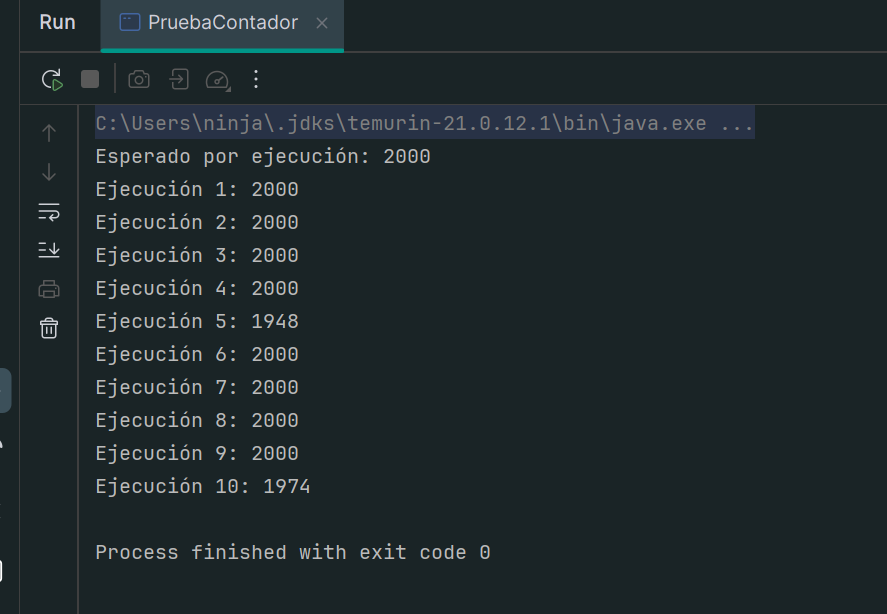

100 000 incrementos por hilo (tanda A): pérdida en las ejecuciones 1, 2, 9 y 10.

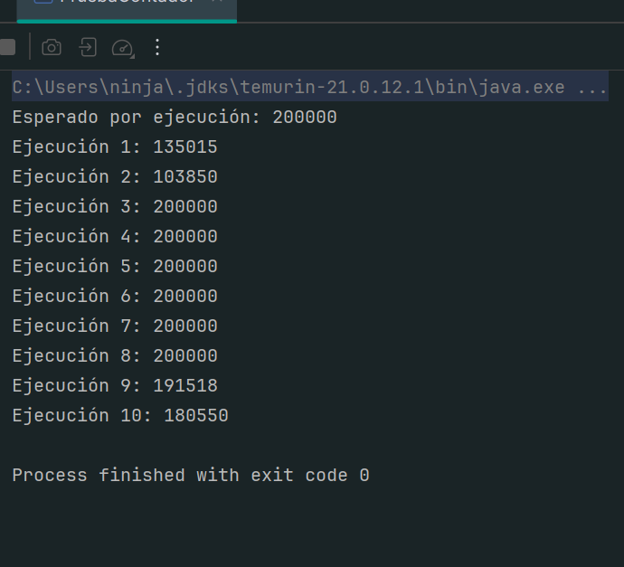

### 11.2 Corrección con `synchronized`

Código de `ContadorCompartido` con `synchronized` en `incrementar()` y `getTotal()`:

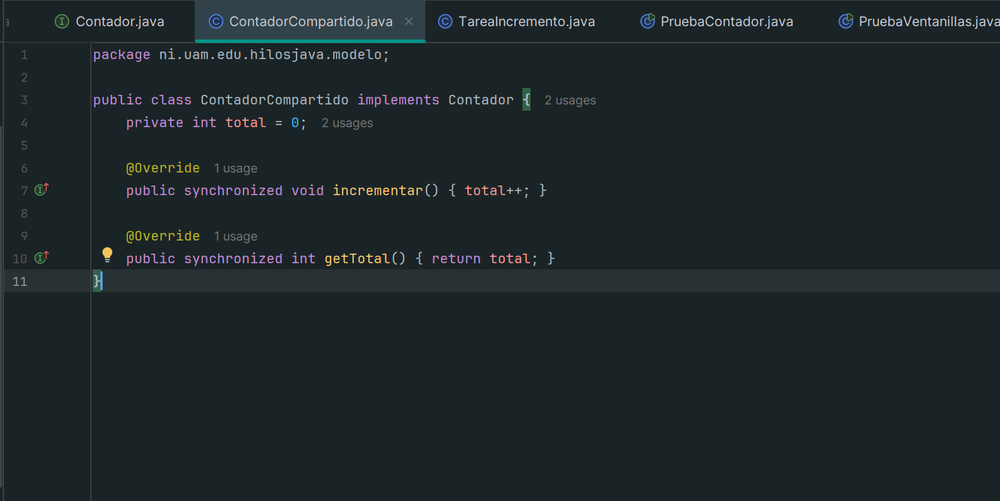

Resultados con 1 000 por hilo (10 de 10 con 2000) y con 100 000 por hilo (10 de 10 con 200000):

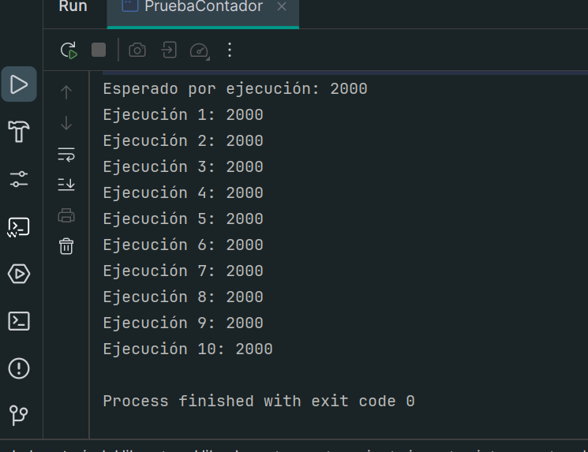

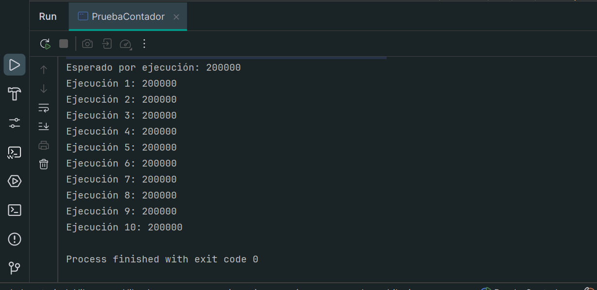

### 11.3 Comparación entre `synchronized` y `AtomicInteger`

Con 1 000 por hilo: `synchronized` 14 ms y `AtomicInteger` 6 ms. Ambos con 10 de 10 correctas.

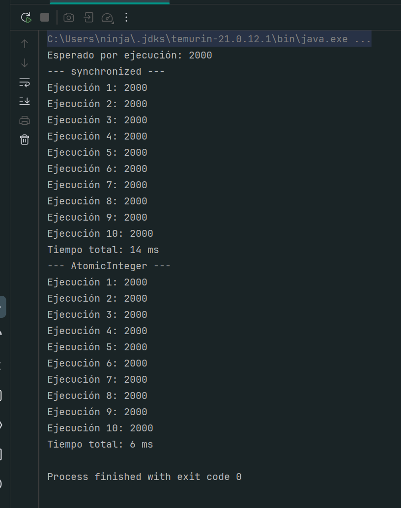

Con 100 000 por hilo: `synchronized` 106 ms y `AtomicInteger` 35 ms. Ambos con 10 de 10 correctas.

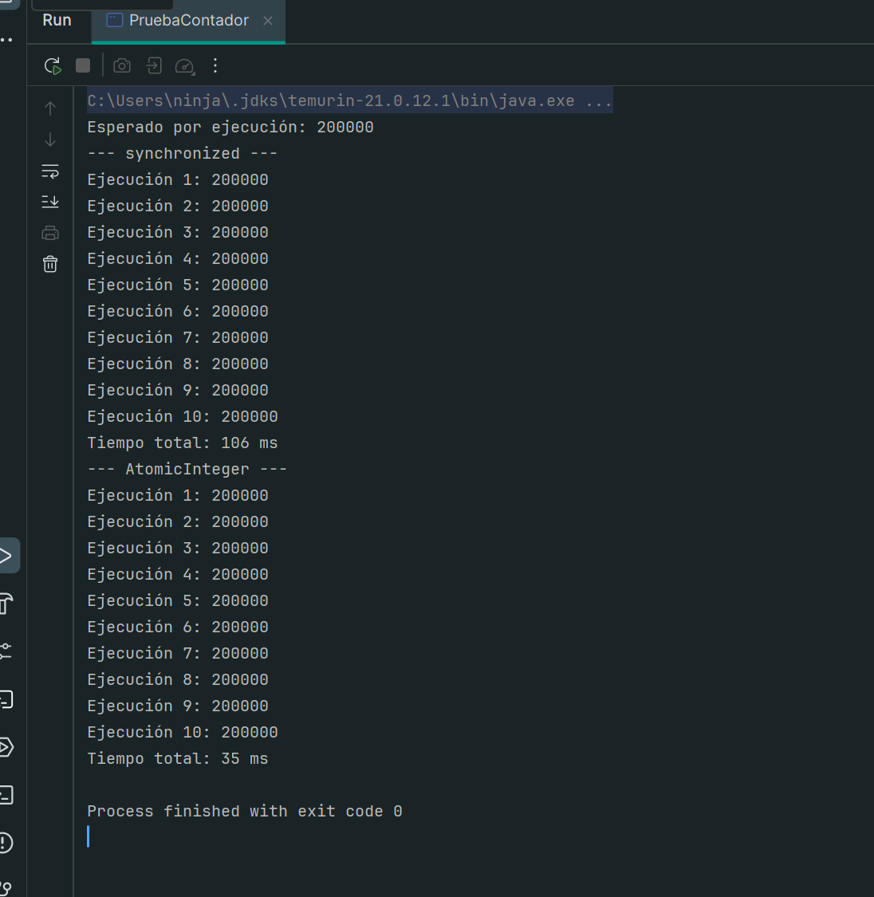

### 11.4 Tandas adicionales sin sincronizar (100 000 por hilo)

Tandas B a F:

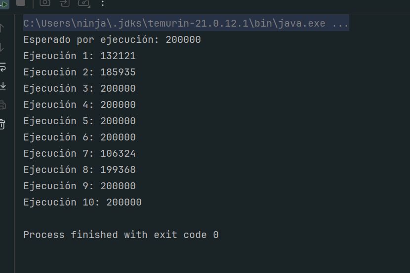

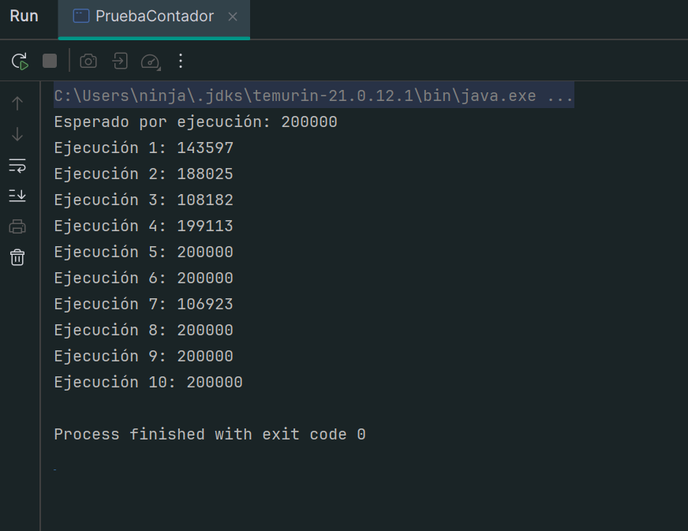

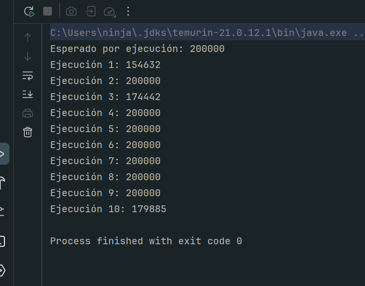

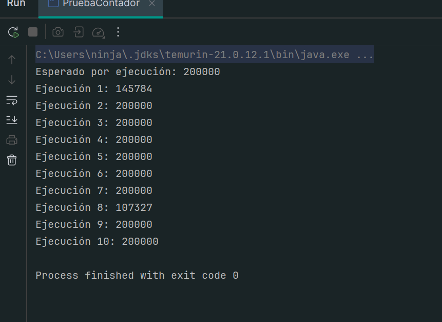

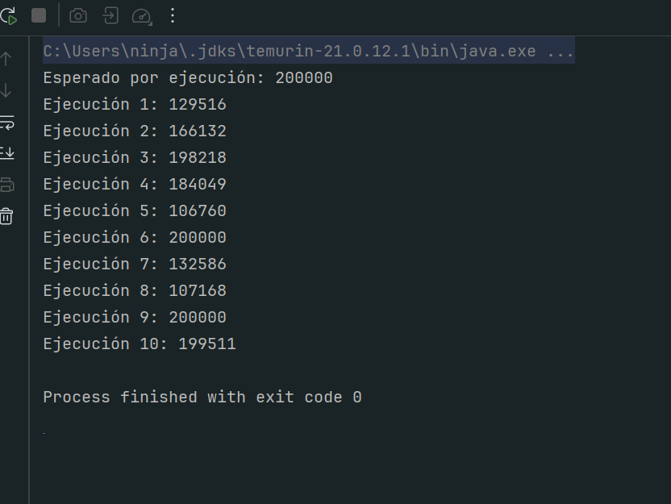

Tanda G, tomada con el IDE ejecutando la versión compilada anterior. El editor muestra `REPETICIONES = 1000`, pero la consola imprime `Esperado por ejecución: 200000`; así se detectó el problema descrito en la sección 9:

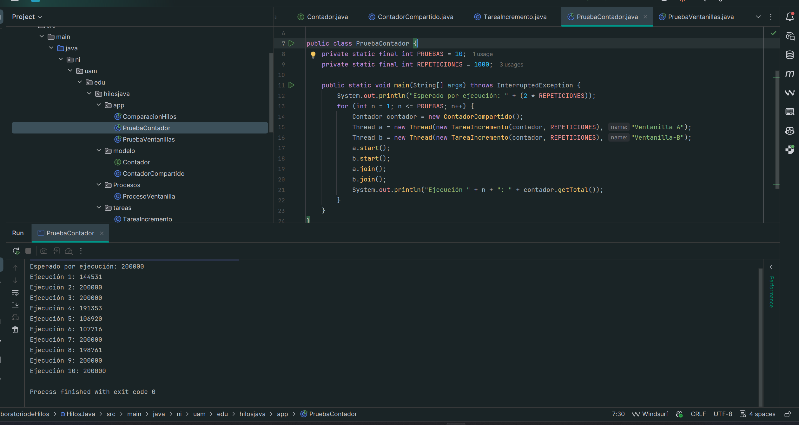
